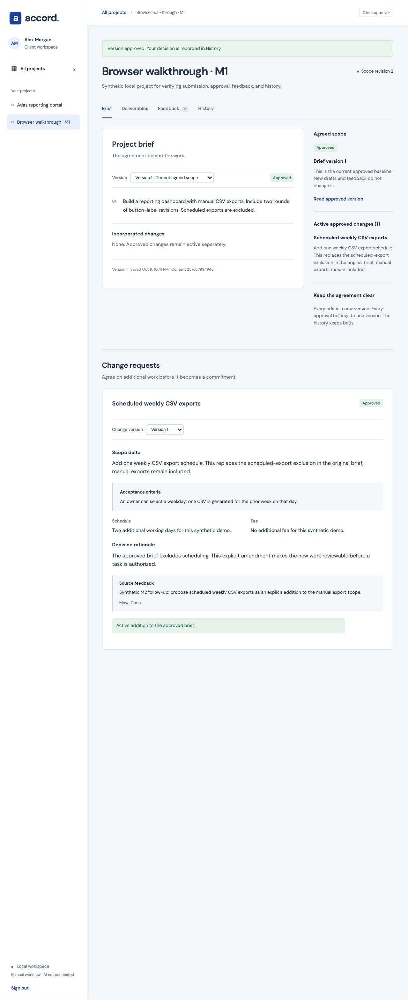

# Accord

**A shared workspace where independent teams and their clients agree on scope,
review work, and preserve every decision.**

Accord turns briefs, deliverables, feedback, and change requests into versioned
records. Clients approve the exact version they reviewed; project owners can
trace later work back to the scope that authorized it.



## What Accord does

- Keeps brief revisions and approved baselines separate, so new drafts never
  overwrite an earlier agreement.
- Gives clients explicit approve/reject controls for briefs and deliverables.
- Converts approved changes and reviewed feedback into accountable revision
  tasks without losing the original conversation.
- Stores project files and draft deliverable attachments with role-based access.
- Records mutations in a project history and applies idempotency safeguards to
  repeated requests.
- Offers a local fixture analysis workflow whose evidence and proposals remain
  subject to human review.

## Product boundaries

The complete collaboration workflow runs locally for a single owner and invited
clients. The cloud preview currently covers authentication, isolated project
access, and versioned brief approvals. Files, deliverables, feedback, change
requests, and analysis remain local. Analysis uses deterministic fixtures; it
does not demonstrate live model quality. See the verification documents in
`docs/` for detailed test and deployment evidence.

## Run locally

Use Node 24.21.0 (`nvm use` if you use nvm) or the available Node 26 runtime. Then:

```sh
npm ci
npm run seed
npm run dev
```

Open **http://127.0.0.1:5173**. The API binds to `127.0.0.1:3001`; Vite proxies `/api`. Use the exact `127.0.0.1` URL because write requests check the frontend origin. Both ports must be available.

Seeding creates three random-password accounts in **`.local/demo-accounts.json`**:

| Account | Role | Visible projects |
| --- | --- | --- |
| `maya@accord.local` | Freelancer | Atlas and Fieldwork |
| `alex@accord.local` | Client approver | Atlas only |
| `jules@accord.local` | Client approver | Fieldwork only |

Open that local file to retrieve passwords; they are not printed in server logs. Re-running the seed preserves existing records and credentials. SQLite data is in `.local/accord.sqlite`. Stop the server and move the entire `.local` directory aside to start a fresh demo. Do not delete it if you need the recorded work.

## Try the workflow

1. Sign in as Maya and open Atlas. Inspect the approved brief and submitted reporting dashboard.
2. Create a new brief version, edit one paragraph, save the draft, then submit it. The previous approved version remains the baseline.
3. Sign out and sign in as Alex. Read the submitted version and approve it using the explicit confirmation. The scope revision advances.
4. In Deliverables, review the acceptance criteria and approve or reject the exact submitted version.
5. In Feedback, select Reporting dashboard to see the seeded compound request. Post feedback or add a correction to your own comment. The original remains visible.
6. In Brief, draft a change request from existing feedback. Enter the scope delta, criteria, schedule, fee and rationale; save and submit it. Sign in as Alex to approve the exact version.
7. As Maya, use Deliverables → Create revision task to record a human decision against the approved brief or an active approved change. Pending changes cannot authorize tasks.
8. Under Private attachments, upload a synthetic PDF, PNG, JPEG or UTF-8 text file (up to 5 MB). Project files are shared context; draft deliverable files remain private until submission. Use Download to request a short-lived, authenticated download.
9. Create a new brief version, incorporate an approved change in its text and select the matching checkbox. Submit and approve it: the change moves into the baseline without being counted twice, and existing tasks retain their original authority.
10. As Maya, open Analysis, choose feedback and run a fixture job. The original Atlas request produces two scripted findings; other context explicitly returns uncertainty. Inspect frozen evidence and record an edited task, private change draft, clarification draft, or rejection. Posting a clarification is a separate action.
11. Add feedback or approve new scope: the old result becomes stale and cannot authorize more actions. Use Recover job for eligible interrupted jobs.
12. Inspect History. Sign in as Jules to see that only Fieldwork is available. Clients cannot access the Analysis tab or its API.

Owner-created projects can be assigned to either existing client. All client and owner permissions are checked by the server, independently of UI visibility. Two browser profiles can be used to review a project concurrently; one profile shares its session across tabs.

## Check the implementation

```sh
npm run check
```

Runs HTTP integration tests, browser-auth unit tests, Python cloud API/deployment tests (Python 3.9+ required), strict TypeScript checking, and both Vite production builds. Tests use disposable SQLite stores, loopback servers and fake cloud clients. Builds are emitted to `dist/web` and `dist/cloud-web`; building does not deploy them. Local development authentication is intentionally not production-ready.

## Cloud preview: briefs and approvals

The cloud preview now supports Cognito sign-in, isolated project access, immutable brief text versions, private drafts, submission, explicit client approval/rejection, version history and an approved baseline. Database transactions commit each mutation, its audit record and idempotency result together. Files, deliverables, feedback, change requests and AI remain available only in the separate local workflow (AI there is fixture-only).

The foundation is already deployed and its browser walkthrough passed on user-reported evidence. **The user reported a successful brief/approval stack update; the live browser walkthrough remains pending.** It reuses the current DynamoDB table, Cognito accounts and LabRole in `us-east-1`.

Build the ZIP with `npm run package:cloud`, then follow [Update the existing stack](scripts/aws-cloud/README.md#update-the-existing-stack--briefs-and-approvals). Do not run `create` or `seed` again for this increment. The existing public configuration and demo passwords remain valid. `npm run dev:cloud` serves the preview at **http://localhost:5174**. Keep AWS credentials out of the frontend and local development server.

## Project map

- `apps/web`: React portal and Vite proxy.
- `apps/api`: local HTTP API, domain operations, persistent store, seed, integration tests.
- `apps/cloud-web`: Cognito sign-in, project directory and versioned brief review.
- `apps/cloud-api`: Lambda project/brief API, transactional DynamoDB adapter and authorization tests.
- `scripts/aws-cloud`: CloudFormation, user-operated deployment/seeding/cleanup and ZIP packaging.
- `packages/shared`: runtime schemas and shared types.
- `docs`: original plans, [implementation decisions](docs/IMPLEMENTATION.md), and [AWS steps for you to run](docs/AWS-USER-CHECKLIST.md).

Read `.env.example` for configuration names. These are environment variables; the development runner does not automatically load `.env`. The default settings need no configuration. If changing API ports, also update the Vite proxy. Keep the API and frontend bound to loopback.

See [M2 verification](docs/M2-VERIFICATION.md) and [M3 fixture workflow, limits and recovery](docs/M3-VERIFICATION.md). The [M4 offline evaluation foundation](docs/M4-EVALUATION.md) now provides 40 synthetic cases, a frozen 20/20 development/holdout split and deterministic scoring tools. Run `npm run eval:validate` or `npm run eval:fixture`; fixture scores are not model-quality evidence. Human gold review and live M4 evaluation remain incomplete. Live inference and live evaluation remain gated on feasibility. The [current feasibility report](docs/Accord-AWS-Feasibility.md) records successful user-operated probe deployment and cleanup; it records the foundation walkthrough separately from the pending brief update, production readiness and Bedrock access.

Runtime references: [Node release schedule](https://github.com/nodejs/Release) and [Vite prerequisites](https://vite.dev/guide/). Dependency versions were resolved from the npm registry on 11 October 2026.
